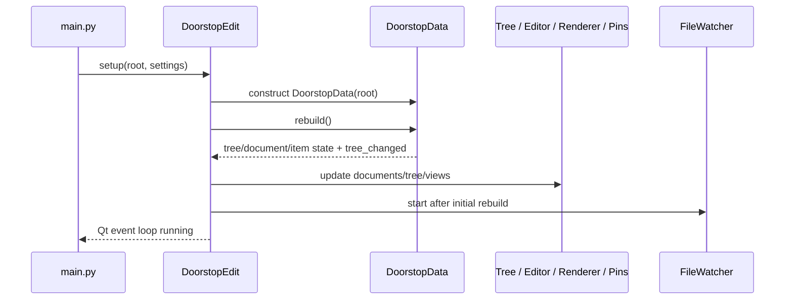

# QML-migratie: frontendanalyse en pariteitsbaseline

**Status:** analyse-output voor Beads Epic `doorstop-edit-qml-frontend-migration-plan-lml.1` (2026-11-05). Dit document legt broninspectie en gaps vast; het is geen volledige handmatige GUI-sign-off.

## 1. Baseline en bewijsgrenzen

- Repository: `/home/digi4care/projects/doorstop-edit`, branch `mvp-1-uv-migration`.
- HEAD toen de analyse startte: `e1de97bdf98e9e644c59f3d9b59d5c6c3b9be472`.
- Werkboom was dirty (ruim 80 gewijzigde/toegevoegde paden) met reeds aanwezig werk aan MVP, requirements, Beads, docs en een geneste QML-prototype-worktree. Dit is **geen schone of releasable migratiebaseline**. De toekomstige implementatie moet vanaf een expliciet gekozen en schoon reviewpunt starten.
- Bronnen zijn de actuele Python/UI-bestanden, lokale tests, bestaande `requirements/REQ-001..009.yml`, `docs/*` en de eerder uitgevoerde prototype-smoke. De GUI is tijdens deze epic niet interactief door alle flows gelopen.
- Dependencies geobserveerd in de huidige environment: PySide6/Qt 6.11.3; `QtQml`, `QtQuick`, `QtQuickControls2`, `QtWebEngineQuick`, `QtWebEngineWidgets` en `QtWebChannel` importeren. Dit bewijst niet dat het huidige WebEngine-/QWebChannel-gedrag in Qt Quick, distributie of elk OS gelijkwaardig werkt.

**Testbaseline bij start analyse (historisch):** `QT_QPA_PLATFORM=offscreen uv run pytest -q` gaf 70 passed, 1 failed, daarna exit 139. De falende requirements-checker-test vond ook de geneste prototype-fixture als tweede Doorstop-root. Deze scopefout is opgelost onder Beads bug `doorstop-edit-qml-frontend-migration-plan-lml.11`: checker gebruikt expliciet `cwd=TREE, root=TREE` en de nested-root regressietest slaagt. De overblijvende exit 139 is onderzocht en opgelost onder `.12`: `test_start_no_exceptions` sloot Qt af zonder `QApplication.exec()` en verwerkte de `QWebEnginePage.deleteLater()`-deferred delete niet. De testfixture flusht nu `QEvent.DeferredDelete` in `finally`. Huidige verificatie: `QT_QPA_PLATFORM=offscreen uv run pytest -q` geeft **72 passed, exit 0** (alleen bestaande pkg_resources-deprecationwarning). Dit is een test-harness-cleanupprobleem; geen productiecrash is aangetoond. Beide issues zijn gesloten; geen applicatiecode werd gewijzigd voor deze fixes.

## 2. Capability-register

`CAP`-IDs zijn stabiele analysetags; ze zijn geen formele Doorstop-requirements. Bestaande Doorstop-requirements dekken slechts delen van gedrag. Iedere rij moet vóór implementatie verder worden opgesplitst tot scenario's waar de eerste inventory-test story details ontdekt.

| ID | Bestaande gebruikersmogelijkheid / gedrag | Implementatiebewijs | Geautomatiseerd bewijs in huidige tests | Nog handmatig te bevestigen / gap |
|---|---|---|---|---|
| CAP-START | CLI-start, `--version`, `--verbose`, optionele project-root, laatst gebruikte map, mapkiezer, ongeldige map afwijzen, splash/logging, afsluiten | `main.py:24-89`; `application.py:52-73,664-688` | `test_main.py::test_start_no_exceptions`, `test_arg_version`; `test_application.py::test_open_folder` | UI-start met/zonder argumenten, invalid path, platform-dialogen, recent-folder reset |
| CAP-WINDOW | Main window; drie zichtbare/dockbare panels (document/item tree, editor, pins); tonen/verbergen, geometry en dock state bewaren/herstellen; dark teal theme | `ui/main.ui:102-160,179-198,838-1154`; `main_window.py:15-80`; `application.py:105-119,648-661` | Geen volledige layout-/restartpariteitstest gevonden | Dock/float/tab/split/resize, restore na monitor/resolutie-wissel en keyboard focus |
| CAP-MENU | File (open, settings, exit, runtime Validate), View-dock toggles, About, tree/editor/link context actions | `ui/main.ui:169-198,838-1154`; `application.py:82-119,381-402`; tree/editor/pins files | Deel van acties in application tests | Volledige action inventory, enablement, confirm/cancel, menu- en contextmenu-gedrag |
| CAP-SETTINGS | Fontgrootte, density, spellcheck on/off/taal, dark theme; persistent preferences | `dialogs/setting_dialog.py:120-193`; `settings.py:9-76`; `main_window.py:51-80` | Geen expliciete volledige preferences round-trip test gevonden | Alle instellingen veranderen, herstart bewaren, ongeldige taal/config, systeemtoegankelijkheid |
| CAP-DOC-NAV | Documentselectie, reload/selection reset, documentboom, document/item current selection | `application.py:215-284,234-262`; `item_tree/item_tree_view.py:118-222` | `test_change_document`, `test_select_tree_item_show_in_edit` | Selection behouden/gewist bij reload, lege boom, deleted selected item |
| CAP-TREE | Item tree met levels/headers en parent-child nesting; active/inactive, review/suspect/normative/validation-status; multi-term zoekfilter; inactive toggle; refresh, expand/collapse; Designer configureert `dragEnabled` en `MoveAction` | `item_tree/item_tree_view.py:24-244`; `ui/main.ui` `item_tree_widget` properties; `document_item_level_tree.py:31-64` | `test_search_tree_item`, `test_select_tree_item_show_in_edit`; validation marker tests | Exacte drag/drop-uitkomst is niet afgeleid uit alleen de property; visuele statushiërarchie, toetsenbordnavigatie, grote boom, filter/selectie interactie en drag/drop moeten handmatig worden bevestigd |
| CAP-TREE-ACTIONS | Context menu: show inactive, reload, expand/collapse, item delete, pin, popup, new item | `item_tree/item_tree_view.py:225-329`; `application.py:353-420` | Deels item/document tests | Iedere actie, confirm/cancel, errors en UI refresh |
| CAP-DOC-OPS | Add/remove documents; prefix/path validation; child delete block; empty state; doc review-all, clear suspect links, reorder levels | `document_dialog.py:19-82`; `doorstop_data.py:203-262`; `application.py:286-338,422-484` | `test_add_document_*`, `test_remove_*`, `test_document_review_all`, `test_document_clear_all_suspect_links`, `test_document_reorder`; `test_document_management_data.py` | Filesystem errors/unmanaged content, permissions, empty/new root, exact confirmation flows |
| CAP-ITEM-OPS | Create/delete item and refresh/select new item | `application.py:353-373`; `item_tree/item_tree_view.py:246-254,292-329` | Coverage partly in app tests; no complete user workflow matrix | Create validation, cancellation, collisions, failure-state consistency |
| CAP-EDIT | All base/custom attributes, input validation/fixups, delayed save, dirty-state, item restoration and error reporting | `item_edit/item_edit_view.py:171-320,322-461,477-500`; `doorstop_data.py:296-345` | `test_edit_item_then_save`, `test_successful_item_save_requests_validation` | Every field type, 700ms debounce, switch with dirty edits, save failure/restore, custom attrs |
| CAP-LINKS | Link list, picker search/select, add/remove, linked-item popup | `item_edit/item_edit_view.py:110-168,502-546`; `item_picker_dialog.py` | `test_item_picker_dialog.py` picker tests | Link/context action failures, invalid/missing target and relationship display |
| CAP-EDIT-UTIL | Undo, markdown format, wrap, copy UID, keyboard shortcut | `item_edit/item_edit_view.py:280-288,548-610`; only explicit shortcut located by grep is Alt+Q for format | `test_mdformat_plugin.py`; no complete interaction tests | Undo scope, focused custom field behavior, clipboard, wrap and shortcut on each OS |
| CAP-REVIEW | Review/unreview fingerprint, review status, clear suspect links, bulk review | `item_edit/item_edit_view.py:463-475,612-634`; `application.py:422-462` | `test_document_review_all`, `test_document_clear_all_suspect_links` | Item review lifecycle, dirty/unreview edge cases and changed fingerprint |
| CAP-DIFF | Item diff, git/history and simple diff modes | `item_edit/item_edit_view.py:594-597`; `dialogs/diff_dialog.py`; `dialogs/differs/` | differ and diff-dialog tests | End-to-end editor→diff and missing git/history/error modes |
| CAP-PINS | Pin/unpin; pinned selection and popup | `pinned_items/pinned_items_view.py:13-65`; tree context action | No dedicated pinned-view test found | Restart persistence policy, deleted item, duplicate pin, popup lifecycle |
| CAP-RENDER | Render item/document/section modes with Markdown/HTML, PlantUML, links/resources, progress, partial render and reload | `item_render/item_render_view.py:111-281`; `render_worker.py:47-276`; markdown helper files | `test_render_paths.py` (3 tests: references/full rerender/progress tracker) | WebEngine display, actual PlantUML/network behavior, all modes, accessibility, worker destruction, large/slow documents |
| CAP-RENDER-NAV | Internal item/document navigation, external-link policy, custom WebEngine page, popup opening, renderer text search | `item_render/item_render_view.py:111-126,257-282`; `application.py:403-420,641-646`; UI renderer search actions | No end-to-end WebEngine navigation/search test found | Click paths, denied/allowed links, popup, search next/previous/clear and malformed URLs |
| CAP-VALIDATE | Validate on tree load, successful save and explicit action; subprocess helper; item findings/status, markers/counts/details, coalescing and stale-result control | `application.py:170-201,504-634`; `validation_helper.py`; `doorstop_data.py:23-102`; tree status at `item_tree_view.py:110-116` | Validation/application/shutdown tests listed below | Packaged helper, multi-project/large project responsiveness, result details UX |
| CAP-WATCH | Existing Watchdog observer, debounce, modified item reload; structural config/create/delete/move rebuild; pause around save; missing-root behavior | `utils/file_watcher.py:14-107`; `doorstop_data.py:125-188,296-320` | Six `utils/test/test_file_watcher.py` tests; three integration tests | Rapid mixed edits, config edit, move/root recovery, platform file event behavior under real load |
| CAP-SHUTDOWN | Stop watcher, stop validation polling/process, bound custom validator wait/reap, render worker teardown, prevent late UI updates; crash log | `application.py:170-213,556-608`; `render_worker.py:194-223`; `crash_log.py` | `test_validation_shutdown.py`, two quit-related app tests, crash-log tests | Quit while render/web engine is active on each OS; process/resource leak checks |
| CAP-EMPTY-ERROR | Empty project and backend/permission/malformed YAML errors must be understandable and leave data state coherent | `application.py`, `doorstop_data.py`, dialog/data paths above | malformed project, empty last document, backend remove-error tests | Complete user-facing error copy, recover/retry and filesystem permissions |
| CAP-I18N-A11Y | No production i18n or comprehensive accessibility capability was proven by inventory | Current widgets/QML prototype sources | No tests found | Screen reader, keyboard-only, scaling, contrast, translations need explicit product requirements rather than being assumed equivalent |
| CAP-GRAPH-NEW | **No current user-visible knowledge graph or ontology feature found.** This is new product scope, not a Widgets capability to migrate. | No graph view/model found in inspected source map | None | User competency questions, ontology vocabulary, live update target, persistence and interoperability are undecided |

### Current test evidence references

- `doorstop_edit/test/test_application.py`: selection/search/edit/save, document changes/order/bulk operations, folder open, validation triggers/markers/coalescing/failures, document create/remove, shutdown.
- `doorstop_edit/test/test_document_management_data.py`: Doorstop API create/remove safety and rebuild.
- `doorstop_edit/test/test_file_watcher_integration.py` and `doorstop_edit/utils/test/test_file_watcher.py`: file modification/deletion/root removal, observer debounce/event classification/stop/restart/missing root.
- `doorstop_edit/test/test_validation.py`, `test_validation_shutdown.py`: validation policy/attribution/malformed items and blocked validator shutdown.
- `doorstop_edit/test/test_render_paths.py`: markdown cross-fragment references, rerender on reference changes, progress tracker. `doorstop_edit/dialogs/test/` and `dialogs/differs/test/`: diff helpers/dialog.
- `doorstop_edit/test/test_item_picker_dialog.py`: picker filter/accept/no selection.
- `doorstop_edit/item_edit/test/test_mdformat_plugin.py`: Markdown formatting plugin preservation.
- `doorstop_edit/test/test_main.py`: startup and version argument.

## 3. Handmatige pariteitsgevallen (nog niet uitgevoerd)

Deze cases zijn de expliciete GUI-acceptatielijst voor de baseline. Automatiseer waar stabiel; voer anders op de huidige Widgets-UI en later op QML uit met dezelfde fixture, en bewaar resultaat/screenshot/log als evidence. Huidige status is **NOT RUN**.

| Case | Scenario en verwachte uitkomst | Gerelateerde capability / bestaande test |
|---|---|---|
| MA-01 | Start zonder args, met geldige root, met invalid root, `--version`, `--verbose`; recent-folder en fout/exit gedrag kloppen. | CAP-START; `test_main.py`, `test_open_folder` |
| MA-02 | Verplaats/resize/floating/tab docks; hide/show elk panel via View menu; herstart en herstel geometry/layout. | CAP-WINDOW |
| MA-03 | Open elk File/View/About/Validate commando en alle dialogs; controleer enabled state, cancel/confirm en enige gevonden shortcut Alt+Q. | CAP-MENU |
| MA-04 | Wissel documenten met/zonder selectie; check document parent/path tooltip, geselecteerd item/editor/render reset en lege project state. | CAP-DOC-NAV; `test_change_document`, empty-project test |
| MA-05 | Navigeer parent/child-levels, header-only `.0`, invalid/malformed item; check review/active/suspect/normative/validation markers, tooltip en eventuele drag/drop. | CAP-TREE; `test_open_project_with_malformed_item_shows_error_marker` |
| MA-06 | Gebruik multi-term search, inactive toggle, clear, reload, expand/collapse; contextmenu op lege ruimte en item. | CAP-TREE, CAP-TREE-ACTIONS; `test_search_tree_item` |
| MA-07 | Maak item voor/na selectie, verwijder item met cancel en confirm; check level, file, selectie en reload. | CAP-ITEM-OPS |
| MA-08 | Voeg document toe met geldig/ongeldig/bestaand prefix, cancel, child parent; verwijder leaf/parent/laatste document en forceer filesystem error. | CAP-DOC-OPS; `test_add_document_*`, `test_remove_*` |
| MA-09 | Review-all, clear suspect links en reorder levels elk met cancel en confirm; controleer files, tree en geselecteerde editor. | CAP-DOC-OPS/CAP-REVIEW; `test_document_*` |
| MA-10 | Bewerk alle native en custom bool/string attrs, header/body/level/links; check validator/fixup, dirty dot, 700ms save en project file. | CAP-EDIT; `test_edit_item_then_save` |
| MA-11 | Bewerk gevolgd door document/item wissel, undo all (cancel/confirm), save error en extern gewijzigde file; UI/data blijven coherent. | CAP-EDIT; `DoorstopData.restore_item` |
| MA-12 | Open link picker, filter, accepteer en cancel; voeg/verwijder link, open linked item popup; check stale target. | CAP-LINKS; item-picker tests |
| MA-13 | Wrap on/off, markdown format met Alt+Q, undo-buffer, custom text field, copy UID en spellcheck/language settings. | CAP-EDIT-UTIL, CAP-SETTINGS |
| MA-14 | Review/unreview item, wijzig na review, clear suspect links; controleer fingerprint en tree/editor-status. | CAP-REVIEW |
| MA-15 | Open diff voor gewijzigde/ongecommitteerde itemdata; git/simple history, missing git, no-history en dialog mode. | CAP-DIFF; diff tests |
| MA-16 | Pin/unpin item; open uit pin list en context popup; wijzig of verwijder item extern en controleer stale pin. | CAP-PINS |
| MA-17 | Render Document/Section/Item; test inactive content, markdown/images/PlantUML/cross-fragment links, progress, reload en groot document. | CAP-RENDER; current worker tests |
| MA-18 | Klik interne, externe, reload en ongeldige rendererlinks; popup open, renderer search next/return/clear; beleid volgt huidige app. | CAP-RENDER-NAV |
| MA-19 | Verander font, density, spellcheck, language, wrap, theme en window settings; herstart en controleer persistentie. | CAP-SETTINGS |
| MA-20 | Trigger validation bij open/save/handmatig; clean/error/warning/malformed findings, markers, details, coalescing, stale revision, helper failure. | CAP-VALIDATE; validation tests |
| MA-21 | Extern wijzig item YAML, maak/verwijder/verplaats YAML en wijzig `.doorstop`; check debounce, reload/rebuild, selection, errors en geen duplicate watcher events. | CAP-WATCH; watcher integration/unit tests |
| MA-22 | Sluit app tijdens validation, slow render/WebEngine load en pending watcher timer; geen late UI update, hang, achterblijvende temp result of crash. | CAP-SHUTDOWN; quit/shutdown tests |
| MA-23 | Keyboard-only, screen reader, scale/high contrast, translation catalog en QML focus order op elke ondersteunde desktop-OS. | CAP-I18N-A11Y; geen volledige huidige evidence |
| MA-24 | Installeer wheel/sdist en start op Linux/macOS/Windows met Python 3.11-3.14; verify QML/Quick/WebEngine resources/plugins. | CAP-START/CAP-RENDER; CI package tests |

## 4. Runtime state/event flow

### Startup to ready project



Evidence: `main.py:36-89`; `application.py:57-168`; `doorstop_data.py:111-188`; view wiring in `application.py:124-157`.

### Selection, edit, save, validation and render

```mermaid
sequenceDiagram
    participant User
    participant Tree as ItemTreeView
    participant App as DoorstopEdit
    participant Edit as ItemEditView
    participant Data as DoorstopData
    participant Validator as Validation helper/process
    participant Renderer as ItemRenderView/RenderWorker/WebEngine
    User->>Tree: select document/item
    Tree->>App: selection/view_item signal
    App->>Data: resolve selected Doorstop item
    App->>Edit: update selected fields
    App->>Renderer: render selected content
    User->>Edit: edit field
    Edit->>Edit: update in-memory item + dirty state
    Edit->>Edit: single-shot save timer (~700 ms)
    Edit->>Data: save_item(item)
    Data->>Data: pause watcher; save file; resume watcher
    Data-->>App: item_saved/item_changed
    App->>Validator: request validation (coalesced)
    App->>Renderer: refresh render/tree for changed item
    Validator-->>App: job/revision-checked findings
    App->>Tree: validation markers/counts/status
    App->>Renderer: worker HTML/progress signals
    Renderer-->>User: WebEngine display/progress/search
```

Evidence: `application.py:124-157,234-284,347-373,504-634`; `item_edit/item_edit_view.py:477-500`; `doorstop_data.py:296-320`; `item_render/item_render_view.py:168-212,228-282`; `render_worker.py:194-276`. Confirm the exact ordering and signal names against source before turning this sketch into implementation API; this is a behavioral map, not a proposed final class contract.

### External changes, validation and shutdown

- Watchdog observer events enter `FileWatcher._queue_change`; a quiet-period timer coalesces updates and structural events supersede content events in a mixed batch. `DoorstopData._on_filewatch_callback` reloads content or calls `rebuild`; app receives tree changes and refreshes list/editor/renderer, with validation requested for changed tree state (`file_watcher.py:14-107`, `doorstop_data.py:141-188`, `application.py:486-503`). Existing REQ-008 specifies a 100ms quiet period but has no named test evidence.
- Validation uses a helper subprocess. New requests coalesce; job/root/revision are checked; timer polling consumes results/errors; stale results are rejected; shutdown stops new requests and reaps/terminates process within bounded policy (`application.py:504-634`).
- Shutdown sequence: mark stopping; stop watcher and validation timer/process; defer cleanup if bounded wait expires; tear down render worker/window (`application.py:170-213,556-608`). Exact interactions with active WebEngine load need manual acceptance.

## 5. Requirements-to-evidence baseline

Existing Doorstop requirement IDs are not a full UI specification:

| Requirement | Current claim | Evidence status |
|---|---|---|
| REQ-001 | Whole-project validation on tree load, successful save, explicit action | Verified; test `test_validation_action_and_tree_feedback` |
| REQ-002 | Coalesce in-flight validation and reject superseded results | Verified; `test_validation_requests_coalesce_while_running` |
| REQ-003 | Built-in validation must not mutate/reformat item files | Verified; `test_validation_policy_stays_stable_and_does_not_write_item_files` |
| REQ-004 | Findings must not block save/edit | Uncovered; requirement metadata explicitly says no evidence |
| REQ-005 | Add document preconditions and UI refresh/selection | Verified; tests `test_add_document_invalid_prefix_stays_open_and_cancel_does_not_create`, `test_add_document_selects_created_child` |
| REQ-006 | Refuse removal with children before destructive work | Verified; `test_remove_parent_with_children_blocked_before_confirmation` |
| REQ-007 | Externally deleted item disappears after successful rebuild | Verified; `test_external_item_deletion_removes_it_after_rebuild` |
| REQ-008 | 100ms quiet period, deliver distinct modified filenames, structural precedence | Untestable per metadata; no event-coalescing evidence anchor exists |
| REQ-009 | Isolated `test_application.py` run exits 0 after assertions | Verified after checker fix: `QT_QPA_PLATFORM=offscreen uv run pytest -q doorstop_edit/test/test_application.py` → 26 passed, exit 0. The former full-suite exit 139 was a separate test_main cleanup path, fixed under Beads `.12`. |

Do not claim formal standard compliance. The QML parity matrix must augment, not silently change, the current Doorstop requirements.

## 6. QML migration boundary and rollout analysis

### Confirmed direction

Use PySide6 Qt Quick/QML as frontend and retain the Python/Doorstop implementation as data/business source of truth for the initial migration. Rust is not part of this epic. Keep typed commands and state in Python; QML should render models and dispatch commands, not mutate raw Doorstop objects or reimplement validation/tree rules.

### Options considered

| Option | Benefit | Cost/risk | Assessment |
|---|---|---|---|
| A. New QML frontend entrypoint alongside Widgets, shared Python application/domain services | Clear boundary; allows parity comparison and fallback; matches existing standalone prototype | Two frontends maintained during transition; requires service/facade extraction from UI-coupled `application.py` | Preferred rollout default, conditional on WebEngine and panel strategy spikes |
| B. Embed QML panes incrementally in existing QMainWindow/QDockWidgets | Reuse native dock shell, pane-by-pane transition | Mixed focus/layout/lifecycle/render stack; QtQuick inside Widgets introduces interop complexity | Keep as alternative if preserving native docking proves hard in full QML; test before selecting |
| C. Replace full Widgets UI in one cutover | No long-term dual UI | Highest regression and release risk; existing WebEngine/docks/tests make rollback costly | Reject as initial approach |

### Recommended gates

1. Freeze a clean baseline and capability-to-test matrix; resolve the current unrelated dirty-tree/test-checker condition.
2. Test PySide6 QML bridge and Qt Quick WebEngine/QWebChannel in a minimal production-shaped spike; prototype proves only QML+Python item editing.
3. Decide whether all panel movement/visibility must exactly match `QDockWidget`, and test chosen QML/hybrid approach.
4. Extract a narrow Python façade/model boundary from `DoorstopEdit`/`DoorstopData`; keep DoorstopData the canonical runtime data owner.
5. Build alternate QML entrypoint; migrate one full workflow at a time with feature-parity tests and a Widgets fallback.
6. Switch default only after OS/package acceptance, user workflow acceptance, data/settings migration and rollback test. Delete Widgets later in a separate approved change.

**Current conflict:** active Beads epic `doorstop-edit-modernize-uv-todos-55b` explicitly says “Keep the existing Qt Widgets architecture; no QML.” The user has since asked for a QML migration plan. Keep both scopes separate: finish/reconcile the active modernization/release scope first; this analysis does not rewrite its past acceptance criteria.

## 7. Two distinct graph/ontology scopes

### A. Migration traceability knowledge graph

Purpose: auditable planning and change-impact navigation. Candidate nodes: Doorstop requirement, `CAP-*` UI capability, source file/symbol, test/manual case, Beads epic/story, evidence artifact and baseline revision. Candidate edges: `implementedBy`, `verifiedBy`, `trackedBy`, `derivedFrom`, `supersedes` (only explicit decision), `impacts`. Each code/evidence edge carries path/symbol/test name, inspected revision and freshness. Generate/validate from Doorstop YAML, capability manifest, test inventory and Beads, and report missing/stale/uncovered links. This graph is not the product graph and does not imply ISO/OMG compliance.

### B. New in-app knowledge graph and ontology

The repository has no current user-visible graph or ontology UI. It is a new opt-in capability. Candidate domain nodes (subject to user/competency-question review): Project, Document, Item/Requirement, Link, Level/Attribute, ReviewState, ValidationFinding, source file/revision. Candidate relationships: document containment/parentage, item links, finding-about-item, evidence/source provenance. Treat Doorstop YAML/tree as source of truth; a graph should be a derived view/model first, not a second editable database.

Candidate architecture: Python builds a typed graph projection from the live Doorstop tree; updates consume existing save/rebuild/watcher signals; QML offers a separate view that navigates to existing tree/editor selection. Persistent graph cache/database and formal RDF/OWL/JSON-LD adoption are not justified yet without user queries, import/export needs, scale measurements and interoperability requirements.

**User decisions (2026-11-05):** the first in-app graph should support all three initial goals: explore document/item/requirement relationships, perform impact analysis, and show live review/suspect-link/validation status. Start with an app-native typed ontology and an in-memory graph derived from Doorstop; Doorstop remains the source of truth. Target visible graph updates within **1 second** after a successful local mutation or external file-watcher update. Do not add a graph database, persistent graph storage, RDF/OWL/JSON-LD export, or a second watcher in v1; revisit only if a concrete interoperability or persistence use-case emerges.

The graph should remain optional and must not replace the document tree or editor. Handle stale events/errors consistently with the existing data model. Detailed ontology labels/edge semantics, graph-query interaction design, performance thresholds for large projects, and validation of the one-second target remain implementation-stage acceptance work.

## 8. Analysis completion status

- [x] Baseline branch/commit/dirty status recorded.
- [x] Broad existing capability register and source/test evidence assembled.
- [x] UI→application→DoorstopData→worker/watcher→UI flow mapped.
- [x] Existing requirement and test coverage gaps recorded, including current baseline test failure.
- [x] QML+Python boundary and staged alternatives compared; no Rust introduced.
- [x] User decisions recorded: all three graph goals; app-native typed, in-memory derived graph; Doorstop source of truth; visible update within 1s; persistence/standard export deferred absent a concrete use-case.
- [x] Stable CAP-IDs and 24 scenario-level manual acceptance cases recorded. The manual cases themselves remain NOT RUN and must be executed on the clean implementation baseline and at cutover; grouping details can be expanded without changing the no-omission requirement.
